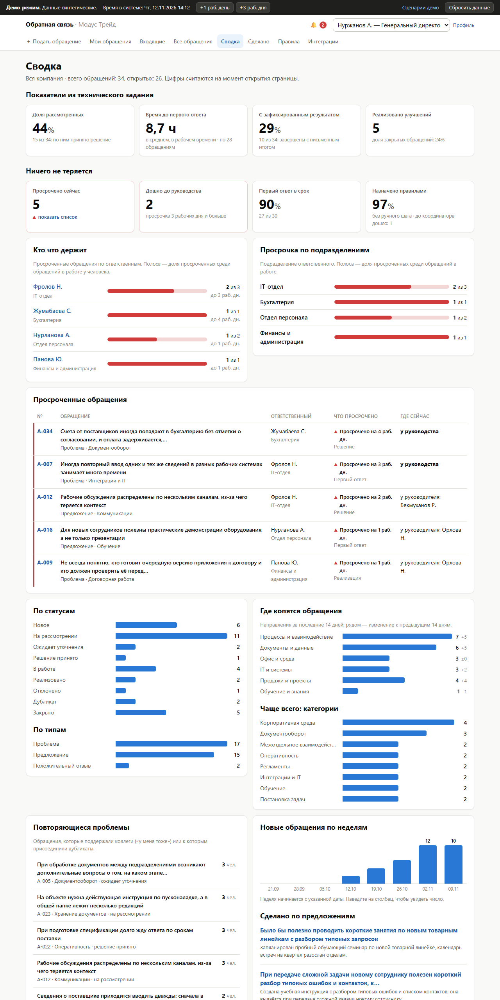
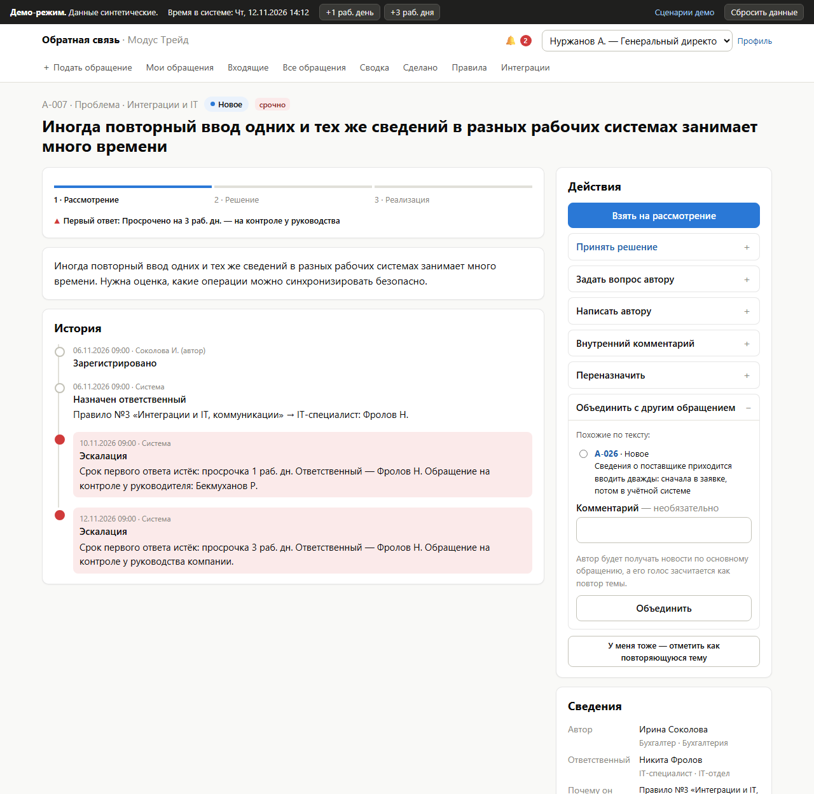
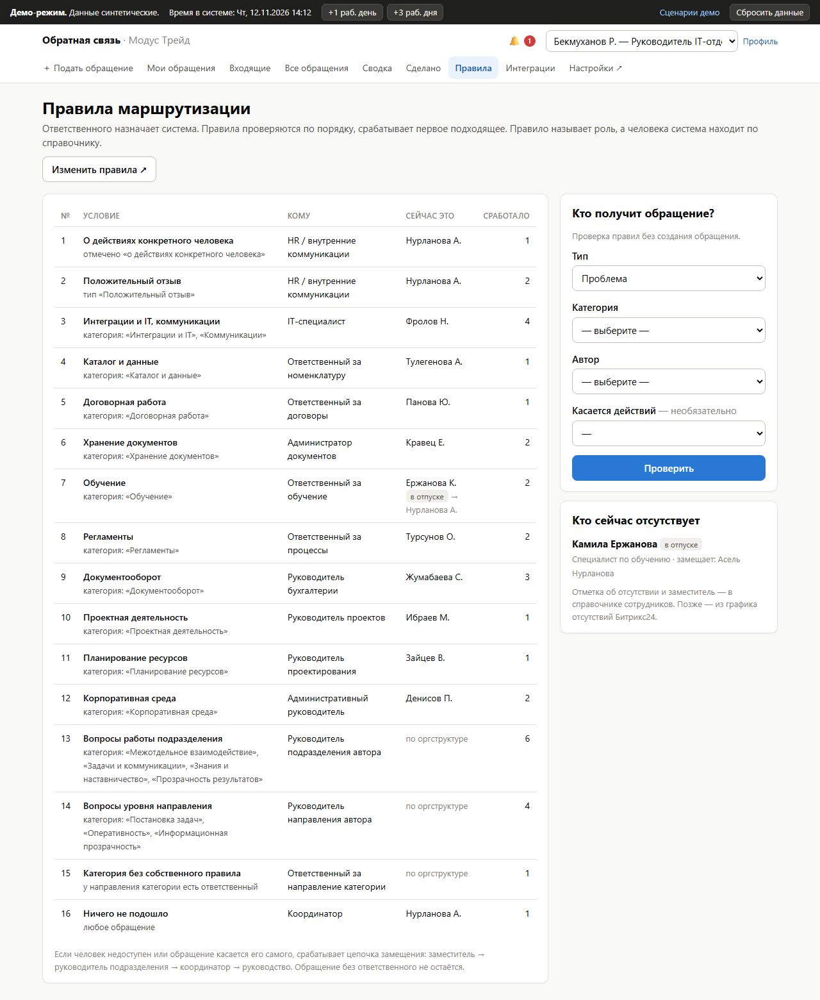
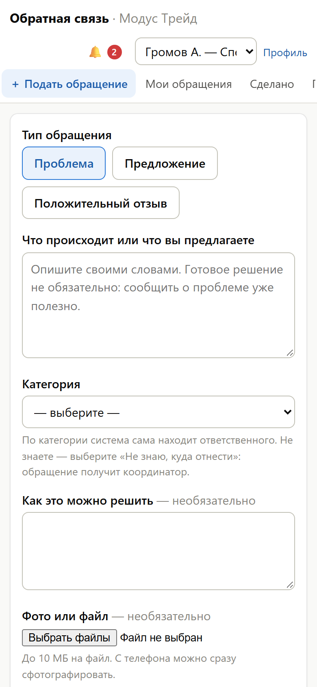
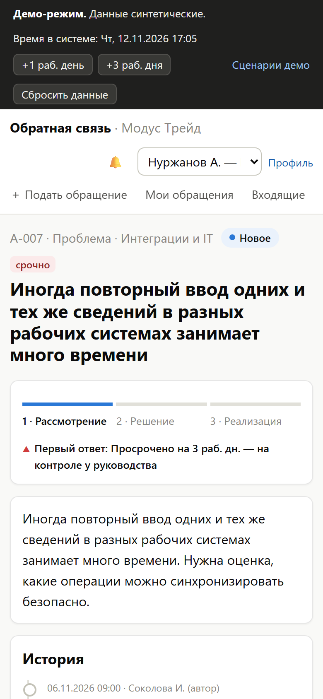
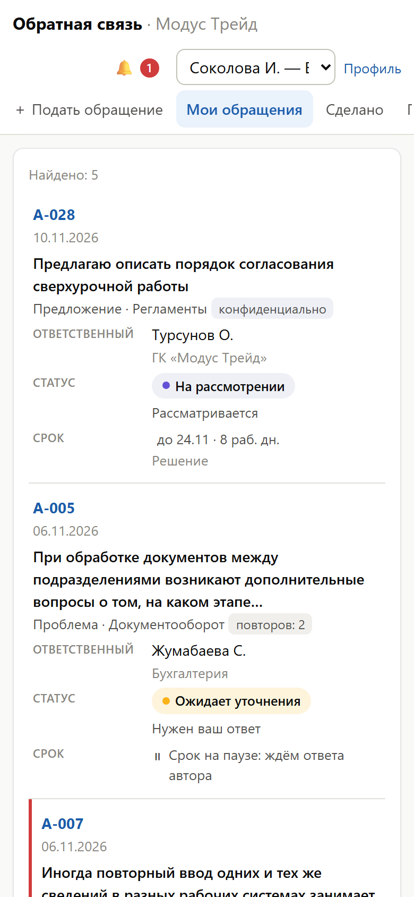

# Employee feedback and suggestions

[Русская версия](README.md)

An entry for the ГК «Модус Трейд» track (Pavlodar IT Hub hackathon, 2026). A working MVP.

> **A guaranteed answer, not a suggestion box.** Every request gets a number, an owner and a deadline at once. If nobody answers, the request moves up on its own: to the department head, then to company leadership. The author always sees what stage their question is at.



The interface is in Russian, because the jury and the users are Russian-speaking.

## For the jury

### The solution in brief

- **The problem.** Questions and ideas reach the company chaotically: by email, as a remark at a meeting, in conversation. The owner has no overall picture, and an employee assumes their issue is being handled when it has been forgotten. In his video, the owner fears that over time people will simply stop speaking up.
- **The solution.** One module for requests: problems, ideas and thanks. Rules pick the assignee, every request has a deadline, and if nobody answers, the request moves up to the manager and then to leadership by itself. Every answer comes with reasons, and the author confirms the result.
- **The value.** Employees see what stage their issue is at and how it ended. Department heads see their department's queue and overdue items. The owner sees the whole picture on one screen: which issues are open and who is holding what.
- **The format.** A working MVP: it starts with one command and uses synthetic data. Telegram is connected for real; Bitrix24 is a simulator, because we have no access to the client's portal.

### Documents

| Document | What it covers |
|---|---|
| [Solution design](docs/solution-design.en.md) | the process for each role, routing rules, statuses and deadlines, escalation, visibility, integrations, rollout, development stages, assumptions |
| [Technical concept](docs/technical-concept.en.md) | modules, data model, screen map, technology choices, security, the path to production |
| [Value proposition](docs/value-proposition.en.md) | how the solution differs from competitors, answers to objections, numbers with sources |
| [User stories](docs/user-stories.en.md) | stories for each role; how employees stay motivated and what keeps the process from fading: rhythm, health metrics, the first 90 days |
| [Spec](docs/task-spec.md), [dataset](docs/dataset.md) | the organizers' materials (in Russian) |
| [Changelog](CHANGELOG.en.md) | what changed and when |

The main version of each document is in Russian; the English version has the `.en.md` suffix. When one changes, the other is updated too.

### Where the spec's requirements are answered

The [spec](docs/task-spec.md) (in Russian) asks every solution to answer three questions (§6):

1. **What business problem does the product solve, and what value does it create?** In brief above; in detail in the [value proposition](docs/value-proposition.en.md).
2. **How does the solution work in practice?** The [request lifecycle](docs/solution-design.en.md#3-request-lifecycle) and [journeys by role](docs/solution-design.en.md#4-journeys-by-role) in the solution design, the [user stories](docs/user-stories.en.md) and the [demo](#how-to-view-the-demo).
3. **How can the product be developed and integrated into the company's systems?** [Development stages](docs/solution-design.en.md#11-mvp-scope), [integrations with Bitrix24, 1C and Telegram](docs/solution-design.en.md#7-integrations), [the path to production](docs/technical-concept.en.md#9-mvp-limitations-and-the-path-to-production).

| What the spec requires | Where to look |
|---|---|
| Product concept, the problem solved, value for users (§4.1) | [The solution in brief](#the-solution-in-brief), [value proposition](docs/value-proposition.en.md), [principles](docs/solution-design.en.md#1-principles) |
| Target users and key scenarios (§4.1) | [Participants](docs/solution-design.en.md#2-participants), [journeys by role](docs/solution-design.en.md#4-journeys-by-role), [user stories](docs/user-stories.en.md) |
| Interface prototype: main screens and how they connect (§4.1, §3.2) | The working app ([running it](#running-it)), [screen map](docs/technical-concept.en.md#4-screens-and-transitions), [screenshots](docs/screenshots/) |
| Technical concept: architecture, technologies, data, security, integrations (§4.1, §3.3) | [Technical concept](docs/technical-concept.en.md) |
| Development plan: the MVP and later stages (§4.1, §3.6) | [MVP scope by stage](docs/solution-design.en.md#11-mvp-scope), [the path to production](docs/technical-concept.en.md#9-mvp-limitations-and-the-path-to-production) |
| Demonstration and an explanation of limitations (§4.1) | [How to view the demo](#how-to-view-the-demo), [known limitations](#known-limitations) |
| Code, instructions to run and demonstrate it (§4.2) | This repository: [running it](#running-it), [how to view the demo](#how-to-view-the-demo), [repository layout](#repository-layout) |
| What is implemented, what simulates external systems, what is planned; known limitations (§4.2) | [What is implemented, what is simulated, what is planned](#what-is-implemented-what-is-simulated-what-is-planned), [known limitations](#known-limitations), the "Integrations" page in the app |
| Test data and end-to-end scenarios (§4.2) | [Test data](#test-data), the organizers' six scenarios in [How to view the demo](#how-to-view-the-demo) |
| How a request reaches its assignee, how status and outcome are recorded, how the author follows progress, why requests don't get lost, how repeats are detected (§2.5) | [Request lifecycle](docs/solution-design.en.md#3-request-lifecycle): routing, statuses, deadlines, escalation, recurring problems |
| Who creates, views, edits and handles requests; anonymity (§2.6) | [Visibility and access](docs/solution-design.en.md#5-visibility-and-access), [access in the technical concept](docs/technical-concept.en.md#6-access) |
| Value metrics (§2.7) | The leadership dashboard (screenshot above), [what leadership sees](docs/solution-design.en.md#45-leadership) |
| Limitations and assumptions (§3.1, §5) | [Assumptions and open questions](docs/solution-design.en.md#12-assumptions-and-open-questions), [known limitations](#known-limitations) |
| How to check usefulness (§3.1) | [How to check usefulness](docs/technical-concept.en.md#10-how-to-check-usefulness), [process health metrics](docs/user-stories.en.md#44-process-health-metrics) |
| Integrations: purpose, data and its direction, method, what to clarify (§3.4) | [Integrations](docs/solution-design.en.md#7-integrations) |
| Data and security (§3.5) | [Data, security, legal](docs/solution-design.en.md#8-data-security-legal), [data protection](docs/technical-concept.en.md#7-data-protection) |

## Running it

You need Python 3.12 or newer. No other services are required: the database is a SQLite file. You don't need a `.env` file either: everything works without it except Telegram, which needs your own bot's token (see [Telegram](#telegram)).

```
python -m venv .venv
.venv\Scripts\activate            # Windows; on Linux and macOS: source .venv/bin/activate
pip install -r requirements.txt
python manage.py rundemo
```

Open <http://127.0.0.1:8000>. The `rundemo` command creates the database, loads the demo data if the database is empty, and starts the server.

Individual commands:

| Command | What it does |
|---|---|
| `python manage.py migrate` | creates or updates the database in `storage/` |
| `python manage.py seed_demo` | rebuilds the demo data from the files in `data/` |
| `python manage.py runserver` | starts the server |
| `python manage.py worker` | escalation and notification delivery as a separate process (in the demo a thread inside the server does this) |
| `python manage.py test` | 83 automated tests |

With Docker: `docker compose up --build`, then <http://localhost:8000>. The image is verified: all tests pass inside the container, and background work runs inside the web process.

## How to view the demo

There is no password login: pick a scenario on the home page, and the system opens as the right employee. You can switch roles in the top right corner. All data is synthetic and all names are invented.

The six demo scenarios from the organizers' dataset ([docs/dataset.md](docs/dataset.md), section 4):

| # | Scenario | Where to look | As whom |
|---|---|---|---|
| 1 | Create a request: type, category, description, file | "Подать обращение"; after submitting, a receipt with the number, owner and deadline | purchasing specialist |
| 2 | Assign an owner by category; an alternative when they are absent | A-016: the training owner is on holiday, so her deputy got the request. "Правила" → the "who will get it" check. A-024: a category with no rule went to the coordinator | project manager, administrator, HR manager |
| 3 | Change status, ask for clarification, keep the history | A-005: a question to the author pauses the deadline; the answer returns the request to review | accountant (author), chief accountant (owner) |
| 4 | Show the author the state and the outcome, including a reasoned rejection | A-017: a rejection with reasons and "what we'll do instead". A-004: the author confirms the result | office manager, purchasing specialist |
| 5 | Filter by department, category, status and deadline; find overdue requests | "Все обращения" → "Просроченные" | CEO |
| 6 | Summary: types, share closed, average time to first response | "Сводка" | CEO |

**You can move time forward.** The "+1 раб. день" and "+3 раб. дня" buttons in the dark bar at the top shift the system clock by working days. Submit a request and press "+3 раб. дня": the first-response deadline passes and the request appears with the owner's manager; two more working days, and it reaches leadership. Each step is written to the request's history. "Сбросить данные" restores the initial state.

| A request with escalation | Routing rules |
|---|---|
|  |  |

**On a phone.** There is no separate app: the same pages rearrange for a narrow screen, and tables turn into cards with field labels. Every page has been checked at 390 px wide.

| Submitting a request | A request with escalation | My requests |
|---|---|---|
|  |  |  |

The other screens are in [docs/screenshots/](docs/screenshots/).

## What is implemented, what is simulated, what is planned

**Implemented**

- Submitting a request from a phone or a computer: type, category, description, proposed solution, attachments, urgency. A receipt with the number, owner and deadlines.
- A category suggestion by keywords and similar requests while typing; a "me too" button instead of a duplicate.
- Rule-based routing: a rule names a role, and the system finds the person in the directory. Backup chain: deputy → manager → coordinator → leadership. A request about a specific person's actions never reaches that person. The rules reproduce the assignment for all 20 of the organizers' requests; an automated test checks this.
- Statuses, a thread with the author, internal comments, a decision with required reasons, next actions and a planned date.
- Deadlines in working days on Kazakhstan's calendar: first response and decision per category, a pause while waiting for the author, one extension with a reason.
- Automatic escalation: a reminder on the last day, the manager after 1 working day overdue, leadership after 3. The thresholds are settings.
- The author confirms the result or sends the request back to work.
- "My requests", an inbox (mine, department queue, escalations, the coordinator's exceptions), search and filters across all requests.
- Dashboard: the four measures from the spec (§2.7), "who is holding what", overdue by department, recurring problems, themes, weekly trend.
- A "Done based on your suggestions" feed.
- Confidential mode, roles and permissions, an activity log in every request.
- Registering a request on an employee's behalf (meeting, call, email).
- Manual reassignment by a manager, and a "Not mine" button that re-runs the rules.
- Reference data, rules, deadlines, the calendar and escalation thresholds are changed in the admin panel without a developer.
- In-app notifications; an outgoing event log with retries and fallback to the next channel.
- Telegram bot: notifications (number, status, link) and account linking with a one-time code. It is covered by automated tests and was checked with a real bot. It needs a bot token (see below).

**Simulated** — we have no access to the client's Bitrix24 portal

- Bitrix24 notifications: instead of sending, the exact REST call `im.notify.system.add` is recorded. It is shown on the "Интеграции" page.
- Employee directory and org structure: loaded from a JSON file in the response format of `department.get` and `user.get`.
- Login: a role switcher instead of authentication.

**Planned**

- Login through Bitrix24, tasks from accepted decisions, embedding in the portal.
- Submission through a Telegram Mini App, action buttons in notifications.
- Changing the category and priority after submission, splitting a request, a "review" mode for meetings, answer templates, answer rating by the author.
- Digests for managers, email intake, context from 1C, anonymous mode, AI suggestions, a Kazakh interface.
- Client feedback and surveys.

Details are in the [solution design](docs/solution-design.en.md), section 11.

## Known limitations

- **No authentication.** The role switcher is fit only for a demo on synthetic data. The "Сбросить данные" and "+1 раб. день" buttons are open to any visitor.
- **The database is SQLite**, and background work runs as a thread inside the web process. Production needs PostgreSQL and a separate `worker` process; the code is ready for that, and the setup is described in the [technical concept](docs/technical-concept.en.md).
- **The holiday calendar is demo data** for 2026–2027. It must be checked against the official production calendar before rollout.
- **Similar-request search** works on shared words, without AI.
- **The interface is in Russian only**; its text is still in templates, not in translation files.
- **Attachments** are checked by type and size; there is no antivirus scan.

## Test data

The demo database is always built from the files in `data/` and is never committed.

| File | Contents |
|---|---|
| `seed_requests.json` | the organizers' 20 requests (produced from their document by `tools/convert_source_docs.py`) |
| `seed_extra_requests.json` | 14 requests added by the team: recurring themes, a confidential request, a request about a person's actions, registration on someone's behalf |
| `seed_timeline.json` | each request's history in relative time: "created 4 working days ago, taken into review a day later…" |
| `seed_directory.json` | 14 departments and 30 employees in Bitrix24's response format |
| `seed_reference.json` | roles, categories, deadlines, 16 routing rules |
| `calendar_kz.json` | the working week and holidays |

The loader replays the histories through the same functions the interface uses. So the deadlines, escalations and dashboard numbers are real and current on the day the data is loaded: on 16 November the demo looks the same as today.

## Telegram

1. Create a bot with [@BotFather](https://t.me/BotFather).
2. Copy `.env.example` to `.env` and fill in `TELEGRAM_BOT_TOKEN`, `TELEGRAM_BOT_USERNAME` and the system's public address in `PUBLIC_BASE_URL`.
3. Restart the server. Log in as the administrator (Бекмуханов Р.) and switch the integration on at the "Интеграции" page.
4. Under any role, open "Профиль" → "Привязать Telegram". On a phone, tap the button; if the page is open on a computer, scan the QR code with the phone's camera. Press "Start" in the bot, and the profile page shows by itself that the account is linked.

Only the request number, the status and a link go to Telegram. Request text and names are not sent.

## Repository layout

```
config/                 Django settings
feedback/
  models.py             data: directory, requests, history, notifications, integrations
  services/             core logic: routing, deadlines, escalation, permissions, analytics
  integrations/         pluggable integrations: dispatcher, Telegram, Bitrix24 simulator
  views.py, templates/  interface
  tests/                tests
data/                   demo data
docs/                   documents for the jury
tools/                  helper scripts
```
