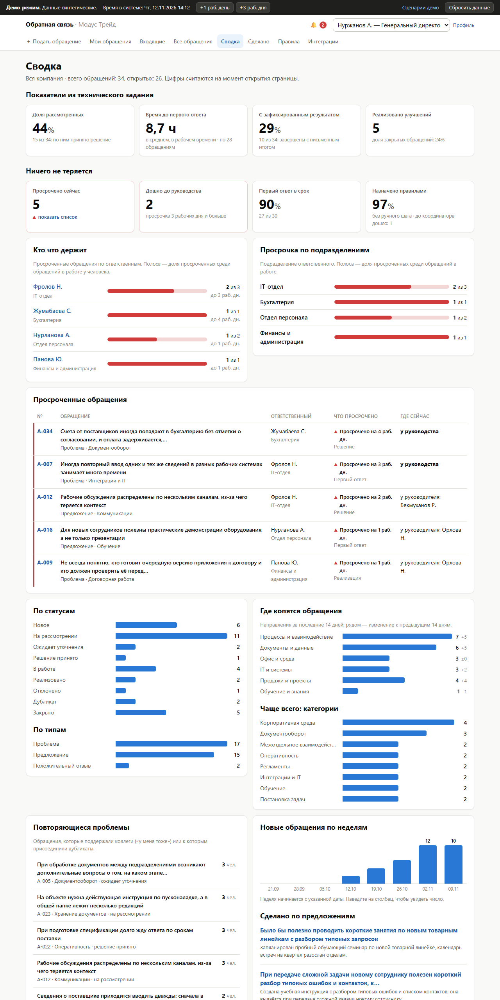
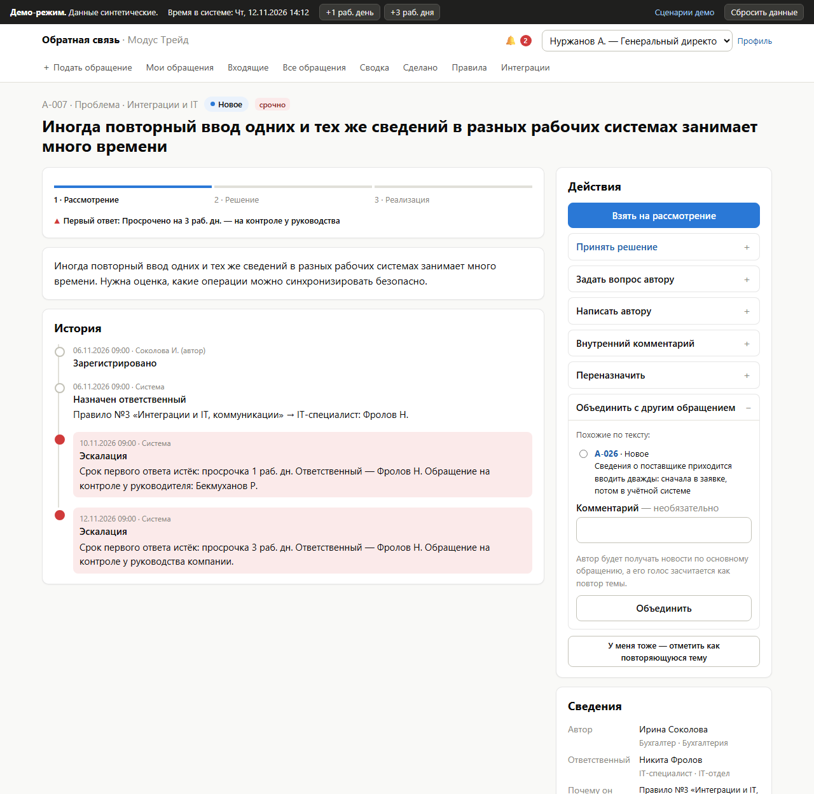
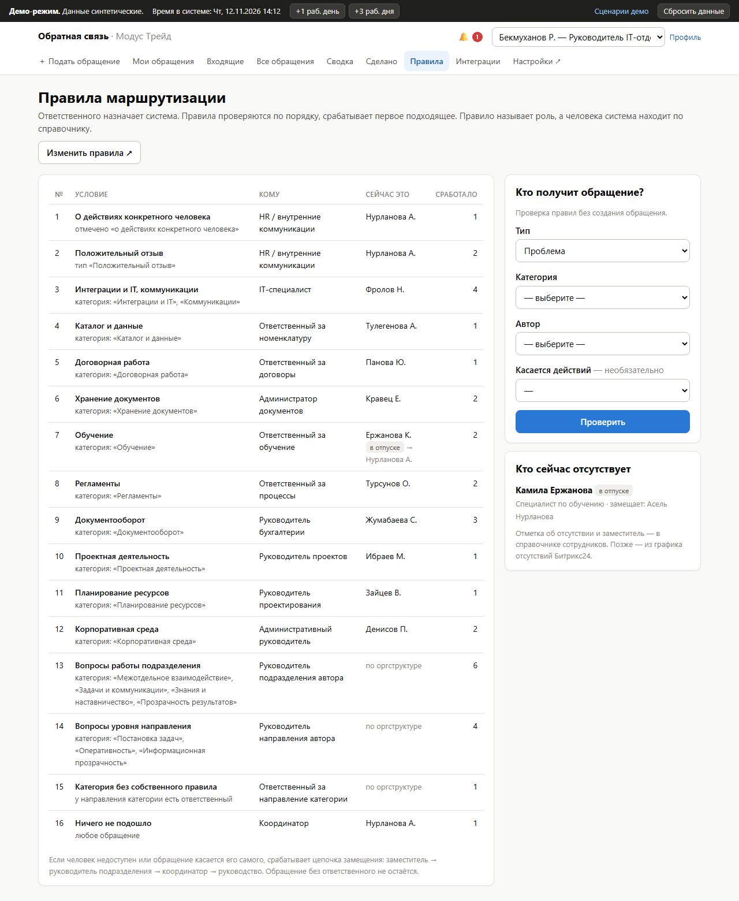

# Обратная связь и предложения сотрудников

[English version](README.en.md)

Решение для трека ГК «Модус Трейд» (хакатон Pavlodar IT Hub, 2026). Работающий MVP.

> **Гарантированный ответ, а не ящик для предложений.** У каждого обращения сразу есть номер, ответственный и срок. Если ответа нет, обращение само поднимается к руководителю подразделения, а затем к руководству компании. Автор всегда видит, на каком этапе его вопрос.



## Запуск

Нужен Python 3.12 или новее. Других сервисов не требуется: база данных — файл SQLite.

```
python -m venv .venv
.venv\Scripts\activate            # Windows; в Linux и macOS: source .venv/bin/activate
pip install -r requirements.txt
python manage.py rundemo
```

Откройте <http://127.0.0.1:8000>. Команда `rundemo` создаёт базу, загружает демо-данные, если база пуста, и запускает сервер.

Отдельные команды:

| Команда | Что делает |
|---|---|
| `python manage.py migrate` | создаёт или обновляет базу в `storage/` |
| `python manage.py seed_demo` | заново строит демо-данные из файлов в `data/` |
| `python manage.py runserver` | запускает сервер |
| `python manage.py worker` | эскалация и доставка уведомлений отдельным процессом (в демо это делает поток внутри сервера) |
| `python manage.py test` | 80 автоматических тестов |

Запуск в Docker: `docker compose up --build`, затем <http://localhost:8000>. Образ проверен: в контейнере проходят все тесты, а фоновая обработка работает внутри веб-процесса.

## Как смотреть демо

Входа по паролю нет: на главной странице выберите сценарий, и система откроется от имени нужного сотрудника. Сменить роль можно в правом верхнем углу. Все данные синтетические, имена вымышлены.

Шесть проверочных сценариев из набора организаторов ([docs/dataset.md](docs/dataset.md), раздел 4):

| № | Сценарий | Где смотреть | От чьего имени |
|---|---|---|---|
| 1 | Создать обращение: тип, категория, описание, файл | «Подать обращение»; после отправки — квитанция с номером, ответственным и сроком | специалист по закупкам |
| 2 | Назначить ответственного по категории; замена при отсутствии | A-016: ответственная за обучение в отпуске, обращение получил заместитель. «Правила» → проверка «Кто получит обращение?». A-024: категория без правила ушла координатору | руководитель проекта, администратор, HR-менеджер |
| 3 | Изменить статус, запросить уточнение, сохранить историю | A-005: вопрос автору ставит срок на паузу, ответ возвращает обращение на рассмотрение | бухгалтер (автор), главный бухгалтер (ответственный) |
| 4 | Показать автору состояние и итог, включая мотивированный отказ | A-017: отказ с обоснованием и «что сделаем вместо этого». A-004: автор подтверждает результат | офис-менеджер, специалист по закупкам |
| 5 | Фильтры по подразделению, категории, статусу и сроку; просроченные | «Все обращения» → «Просроченные» | генеральный директор |
| 6 | Сводка: типы, доля закрытых, среднее время первого ответа | «Сводка» | генеральный директор |

**Время можно перемотать.** Кнопки «+1 раб. день» и «+3 раб. дня» в тёмной полосе сверху сдвигают время в системе. Подайте обращение и нажмите «+3 раб. дня»: срок первого ответа истечёт, обращение появится у руководителя ответственного; ещё два рабочих дня — у руководства. Каждый шаг записывается в историю обращения. «Сбросить данные» возвращает исходное состояние.

| Обращение с эскалацией | Правила маршрутизации |
|---|---|
|  |  |

Остальные экраны — в [docs/screenshots/](docs/screenshots/).

## Что реализовано, что имитируется, что в планах

**Реализовано**

- Подача обращения с телефона или компьютера: тип, категория, описание, предлагаемое решение, вложения, срочность. Квитанция с номером, ответственным и сроками.
- Подсказка категории по ключевым словам и похожие обращения при вводе текста; кнопка «У меня тоже» вместо дубликата.
- Маршрутизация по правилам: правило называет роль, человека система находит по справочнику. Цепочка замещения: заместитель → руководитель → координатор → руководство. Обращение о действиях конкретного человека никогда не попадает к этому человеку. Правила воспроизводят назначение для всех 20 обращений организаторов — это проверяет автоматический тест.
- Статусы, переписка с автором, внутренние комментарии, решение с обязательным обоснованием, дальнейшими действиями и плановой датой.
- Сроки в рабочих днях по календарю Казахстана: первый ответ и решение для каждой категории, пауза на время ожидания автора, одно продление с причиной.
- Автоматическая эскалация: напоминание в последний день, через 1 рабочий день просрочки — руководителю, через 3 — руководству. Пороги настраиваются.
- Автор подтверждает результат или возвращает обращение в работу.
- «Мои обращения», «Входящие» (мои, очередь подразделения, эскалации, исключения координатора), поиск и фильтры по всем обращениям.
- Сводка: четыре показателя из ТЗ (§2.7), «кто что держит», просрочка по подразделениям, повторяющиеся проблемы, темы, динамика по неделям.
- Лента «Сделано по вашим предложениям».
- Конфиденциальный режим, роли и права, журнал действий в каждом обращении.
- Регистрация обращения со слов сотрудника (совещание, звонок, письмо).
- Ручное переназначение руководителем и кнопка «Не моё», которая заново применяет правила.
- Справочники, правила, сроки, календарь и пороги эскалации меняются в панели администратора без разработчика.
- Уведомления в системе; журнал исходящих событий с повторами и переходом на следующий канал.
- Telegram-бот: уведомления (номер, статус, ссылка) и привязка аккаунта одноразовым кодом. Покрыт автоматическими тестами и проверен с настоящим ботом. Нужен токен бота (см. ниже).

**Имитируется** — доступа к порталу Битрикс24 заказчика у нас нет

- Уведомления в Битрикс24: вместо отправки записывается точный REST-запрос `im.notify.system.add`. Его видно на странице «Интеграции».
- Справочник сотрудников и оргструктура: загружаются из JSON-файла в формате ответов `department.get` и `user.get`.
- Вход: переключатель ролей вместо аутентификации.

**В планах**

- Вход через Битрикс24, задачи из принятых решений, встраивание в портал.
- Подача через Telegram Mini App, кнопки действий в уведомлениях.
- Изменение категории и приоритета после подачи, разделение обращения, режим «Разбор» для совещаний, шаблоны ответов, оценка ответа автором.
- Дайджесты для руководителей, приём писем, контекст из 1С, анонимный режим, ИИ-подсказки, казахский интерфейс.
- Обратная связь клиентов и опросы.

Подробности — в [описании решения](docs/solution-design.md), раздел 11.

## Известные ограничения

- **Нет аутентификации.** Переключатель ролей годится только для демонстрации на синтетических данных. Кнопки «Сбросить данные» и «+1 раб. день» доступны любому посетителю.
- **База — SQLite**, фоновая обработка — поток внутри веб-процесса. Для эксплуатации нужны PostgreSQL и отдельный процесс `worker`; код к этому готов, настройка описана в [технической концепции](docs/technical-concept.md).
- **Календарь праздников — демо-данные** на 2026–2027 годы. Перед внедрением его нужно сверить с официальным производственным календарём.
- **Поиск похожих обращений** работает по совпадению слов, без ИИ.
- **Интерфейс только на русском**; тексты пока лежат в шаблонах, а не в файлах перевода.
- **Вложения** проверяются по типу и размеру, антивирусной проверки нет.

## Тестовые данные

Демо-база всегда строится из файлов в `data/` и в репозиторий не попадает.

| Файл | Что в нём |
|---|---|
| `seed_requests.json` | 20 обращений организаторов (получены из их документа скриптом `tools/convert_source_docs.py`) |
| `seed_extra_requests.json` | 14 обращений команды: повторяющиеся темы, конфиденциальное обращение, обращение о действиях человека, регистрация со слов сотрудника |
| `seed_timeline.json` | история каждого обращения в относительном времени: «создано 4 рабочих дня назад, взято на рассмотрение через день…» |
| `seed_directory.json` | 14 подразделений и 30 сотрудников в формате ответов Битрикс24 |
| `seed_reference.json` | роли, категории, сроки, 16 правил маршрутизации |
| `calendar_kz.json` | рабочая неделя и праздники |

Загрузчик проигрывает истории через те же функции, что и интерфейс. Поэтому сроки, эскалации и цифры в сводке настоящие и актуальны на день загрузки: 16 ноября демо выглядит так же, как сегодня.

## Telegram

1. Создайте бота у [@BotFather](https://t.me/BotFather).
2. Скопируйте `.env.example` в `.env`, впишите `TELEGRAM_BOT_TOKEN`, `TELEGRAM_BOT_USERNAME` и публичный адрес системы в `PUBLIC_BASE_URL`.
3. Перезапустите сервер. Войдите как администратор (Бекмуханов Р.) и включите интеграцию на странице «Интеграции».
4. Под любой ролью откройте «Профиль» → «Привязать Telegram».

В Telegram уходят только номер обращения, статус и ссылка. Текст обращений и имена не передаются.

## Устройство репозитория

```
config/                 настройки Django
feedback/
  models.py             данные: справочник, обращения, история, уведомления, интеграции
  services/             логика ядра: маршрутизация, сроки, эскалация, права, аналитика
  integrations/         подключаемые интеграции: диспетчер, Telegram, имитация Битрикс24
  views.py, templates/  интерфейс
  tests/                тесты
data/                   демо-данные
docs/                   документы для жюри
tools/                  вспомогательные скрипты
```

## Документы

| Документ | О чём |
|---|---|
| [Описание решения](docs/solution-design.md) | процесс для каждой роли, правила маршрутизации, статусы и сроки, эскалация, видимость, интеграции, внедрение, этапы развития, допущения |
| [Техническая концепция](docs/technical-concept.md) | модули, модель данных, карта экранов, выбор технологий, безопасность, путь к эксплуатации |
| [Ценностное предложение](docs/value-proposition.md) | чем решение отличается от конкурентов, ответы на возражения, цифры с источниками |
| [Техническое задание](docs/task-spec.md), [набор данных](docs/dataset.md) | материалы организаторов |
| [История изменений](CHANGELOG.md) | что и когда менялось |

У документов есть английские версии с суффиксом `.en.md`. При изменении одной версии обновляется и вторая.
