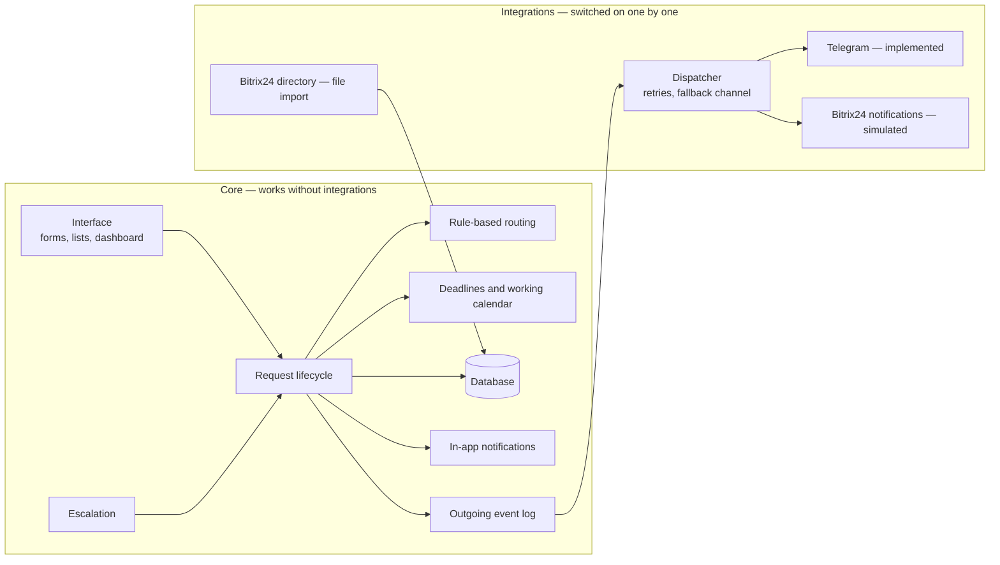
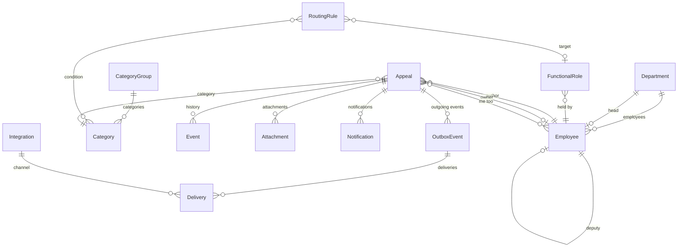
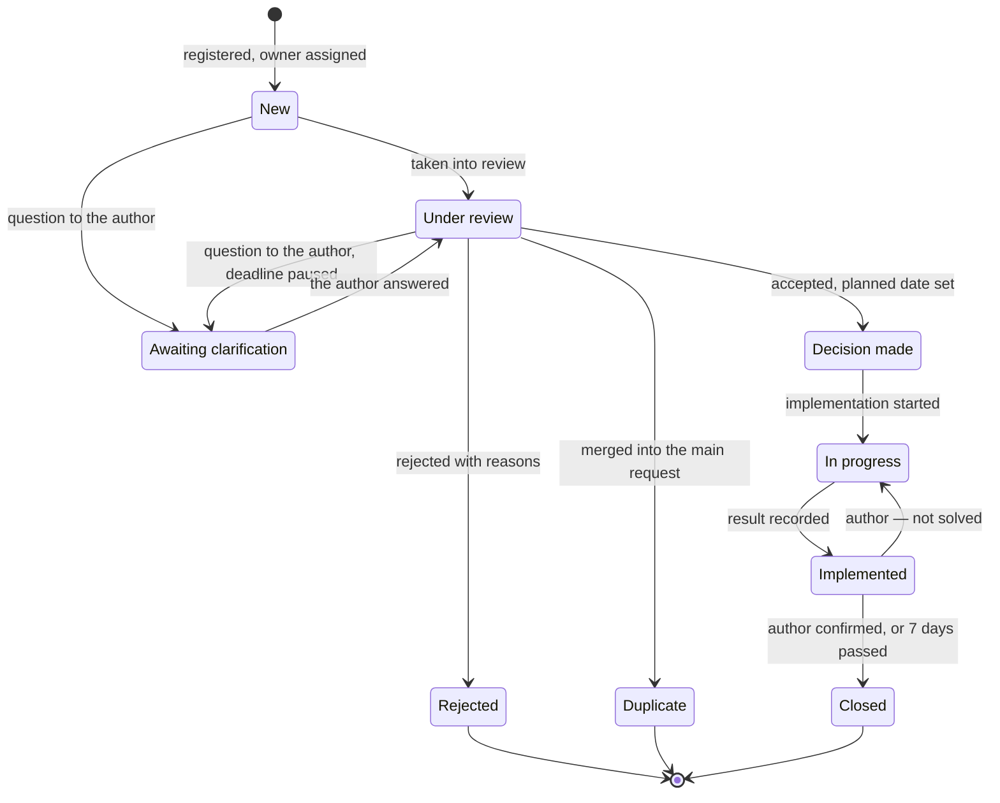
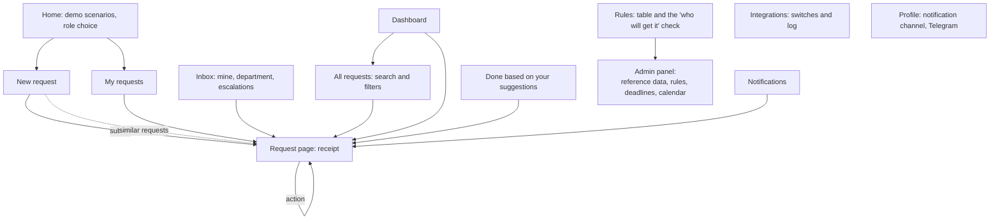

# Technical concept

[Русская версия](technical-concept.md)

How the solution is built: modules, data, screens, technologies, security, the MVP's limitations and the path to production (spec §3.2, §3.3, §3.5, §4.1). The process for each role is in the [solution design](solution-design.en.md); how to run it is in the [README](../README.en.md).

## 1. The main architectural idea

The owner asked teams to propose "which modules, and how to build them". The answer is **a core and pluggable integrations**.

- **The core** does everything a guaranteed answer needs: requests, routing rules, deadlines, escalation, the dashboard, in-app notifications. It works without a single external system.
- **Integrations** are plugged in one by one. The core knows nothing about them: it writes events to an outgoing event log, and the integrations that are switched on pick them up from there.

So a user action never waits for an external system. If Telegram or Bitrix24 is down, the request is still registered and the notification stays in the app.

## 2. Modules

| Module | What it does | Where in the code |
|---|---|---|
| Directory | departments, employees, managers, deputies, the absence flag, owner roles | `feedback/models.py`, the admin panel |
| Categories and deadlines | areas and categories of requests; for each, a first-response deadline and decision deadlines | `feedback/models.py` |
| Routing | checks the rules in order, finds the person by role, applies the backup chain | `feedback/services/routing.py` |
| Lifecycle | registration, statuses, a question to the author, decision, implementation, confirmation; each action is one function with a permission check | `feedback/services/workflow.py` |
| Working calendar | counts deadlines in working days; days off, working hours and holidays are data, not code | `feedback/services/workcal.py` |
| Escalation | a reminder on the last day, then the manager, then leadership; closes unconfirmed results | `feedback/services/escalation.py` |
| Permissions and visibility | who sees what and who may do what | `feedback/services/permissions.py` |
| Similar requests | a category suggestion and a search for similar requests by shared words | `feedback/services/similar.py` |
| Analytics | dashboard measures, "who is holding what", recurring themes | `feedback/services/metrics.py` |
| Notifications | in-app notifications and a row in the outgoing event log | `workflow.notify`, the `Notification` and `OutboxEvent` models |
| Integrations | the dispatcher, the Telegram channel, the Bitrix24 simulator, the directory import | `feedback/integrations/` |
| Background work | every few seconds runs escalation and the dispatcher | `feedback/services/worker.py` |
| Demo | a clock that can be moved forward; the demo data loader | `feedback/services/clock.py`, `seed.py` |
| Interface | pages and forms | `feedback/views.py`, `feedback/templates/` |

The logic lives in `services/`, not in the pages: pages only read input and show the result. So the tests check the rules of the process directly, and the interface can be replaced (for example, by an app inside Bitrix24) without touching the core.

## 3. Data

| Table | What it stores |
|---|---|
| `Department`, `Employee` | the org structure; for an employee, the access level, deputy, absence flag and notification channel |
| `FunctionalRole` | a role a rule points to ("IT specialist", "Contracts owner") and who holds it |
| `CategoryGroup`, `Category` | areas and categories, deadlines, keywords for the suggestion |
| `RoutingRule` | the order of checking, the conditions (type, categories, the author's department, priority, "about a person's actions") and the target |
| `Appeal` | a request: type, text, author, owner, the rule that fired, status, deadlines, decision, result, escalation level |
| `Event` | a request's history: who did what and when; visible "to the author" or "to the people handling it only". It is the timeline, the thread and the activity log at once |
| `Attachment` | attachments |
| `Notification` | in-app notifications |
| `OutboxEvent`, `Delivery` | the outgoing event log and delivery attempts with the exact request to the external system |
| `Integration` | the switch, the mode (implemented, simulated, planned) and the state of each integration |
| `Holiday`, `SystemSettings` | the calendar, escalation thresholds, the urgency factor |

Requests are never deleted. A request's text does not change after submission: the author can only add a message.

### Request lifecycle

The author sees the three stages the owner spoke about: consideration, decision, implementation.

## 4. Screens and transitions

The interface prototype is the working application itself. Screenshots are in [screenshots/](screenshots/).

| Screen | For whom | What is on it |
|---|---|---|
| New request | everyone | three required fields; a category suggestion and similar requests; confidentiality; for a manager, registering on an employee's behalf |
| Request page | the people involved; colleagues if the author allowed it | stage, deadline, text, decision, history, actions for the viewer's role |
| My requests | the author | status in plain words; a "your action is needed" block |
| Inbox | owners and managers | a queue by deadline: overdue first |
| All requests | managers, the coordinator, leadership | search and filters by department, category, status, type, deadline |
| Dashboard | managers, the coordinator, leadership | the spec's measures, overdue requests, "who is holding what", repeats, themes |
| Done | everyone | implemented suggestions and colleagues' open requests with a "me too" button |
| Rules | everyone, read-only | 16 rules, who holds each role now, the "who will get it" check |
| Integrations | everyone read-only; the administrator switches | each integration's mode and the request log |
| Admin panel | the administrator | categories, deadlines, rules, roles, employees, calendar, thresholds |

The pages are built for phones, with one stylesheet and no separate mobile version. Grids fall back to one column on their own, the menu scrolls sideways, and below 640 px tables turn into cards with field labels. Every page has been checked at 390 px wide, with no horizontal scrolling. Screenshots are in [screenshots/](screenshots/), files 11–13.

## 5. Technologies and why

| What | Choice | Why |
|---|---|---|
| Language and framework | Python 3.12, Django 5.2 (a long-term-support release) | The built-in admin panel covers the spec's requirement "administrators manage categories and rules" with no extra development. The ORM, migrations, sessions, file uploads and Russian localisation are included. A common stack is easier to maintain |
| Interface | pages rendered on the server, a little JavaScript with no build step | One project instead of two, one command to run, works on a weak phone and a slow connection |
| Database | SQLite in the demo, PostgreSQL in production | The demo needs no separate server; the switch is one setting, and the code does not change |
| Background work | an outgoing-events table and our own processing loop | No message broker or scheduler is needed. An event is not lost: it is written to the database first and sent afterwards |
| Telegram | the Bot API through Python's standard library | No extra dependencies; the bot polls for updates itself, so it does not need a public address |
| Running | gunicorn and WhiteNoise; a Dockerfile is included | One process, one data volume |

There are four dependencies: Django, WhiteNoise, gunicorn, tzdata.

**What we considered and why we did not choose it**

| Option | Why not |
|---|---|
| Configuring a smart process in Bitrix24 | We have no access to the client's portal. It needs the Professional plan. Escalation to leadership, "authors see only their own" permissions and the owner's screen would still have to be built by hand. More in the [value proposition](value-proposition.en.md) |
| A separate server (API) and client (React or Vue) | Better for a rich interface, but it is two projects, a build step and our own admin panel. Within the hackathon's time it would give less finished result |
| No-code builders | Routing, working days and escalation would still have to be programmed |

The core is not tied to Django pages: a REST API can be added to it for an app inside Bitrix24 or a mobile client.

## 6. Access

In the MVP three things decide access: the employee's access level (employee, coordinator, leadership, administrator), their place in the org structure (a department head sees their department's queue) and their relation to the request (author, owner).

- Every action is checked in one place, `permissions.actions()`; a page shows only the allowed buttons, and the server checks the permission again.
- A confidential request: the author's name is hidden from the owner and the department head, and visible to the coordinator and leadership.
- A request about a specific person's actions is invisible to that person, both in lists and by direct link; views are written to the history.
- Internal comments are not shown to the author.

The full "who sees what" and "who can do what" tables are in the [solution design](solution-design.en.md), section 5.

**Login.** In the demo it is a role switcher. The next stage is login through Bitrix24 (OAuth 2.0) or our own login by an email link. The code gets the current employee in one place (`feedback/middleware.py`), so the login method changes without reworking the rest.

## 7. Data protection

- **Storage in Kazakhstan.** The system is meant to be hosted in a Kazakh cloud or on the company's server (the Law on Personal Data and Its Protection, art. 12). A lawyer should check the legal conclusions.
- **Minimal data.** Name, job title, department, work email. No passport or private details.
- **Only the number, the status and a link leave the system.** Neither request text nor names go to Telegram or Bitrix24; automated tests check this.
- **Secrets** (the bot token, the application key) are set through environment variables and are stored neither in the repository, nor in the database, nor in the integration log.
- **Attachments** are limited by type and size and are served only to people who can see the request.
- **The activity log** is kept in each request's history; changes to reference data and rules are logged by the admin panel.
- **Demo data is synthetic** (spec §3.5).

## 8. Tests

80 automated tests run with `python manage.py test`. The core's tests run with every integration switched off, which checks the architecture's main promise.

| What is checked | Examples |
|---|---|
| Routing | the rules reproduce the assignment for all 20 of the organizers' requests; a deputy when the owner is absent; a request about a person does not reach them; nobody handles their own request |
| Deadlines | working days, holidays, pause and extension |
| Escalation | 1 and 3 working days overdue, weekends do not count, a repeated run duplicates nothing |
| Process | a decision without reasons is not accepted; confirmation and return to work |
| Visibility | a confidential author is hidden; internal comments are not visible to the author |
| Integrations | the core does not touch the network; the simulator records the exact request; on a Telegram failure, retries and a fallback channel |
| Demo | the organizers' six scenarios; moving the clock leads to escalation |

## 9. MVP limitations and the path to production

| Now | What production needs |
|---|---|
| A role switcher instead of a login | Login through Bitrix24 or our own; switch demo mode off (`DEMO_MODE=0`) |
| SQLite | PostgreSQL |
| Background work is a thread in the web process | A separate `python manage.py worker` process (`INLINE_WORKER=0`) |
| Bitrix24 is simulated | A webhook or an app on the client's portal with permissions for users, departments and notifications |
| Telegram is checked with a real bot at a local address | A public address for the system, so the notification carries an "Open" button, and a bot owned by the company |
| The calendar is demo data | A check against the production calendar, and a yearly update in settings |
| No backups or channel encryption | HTTPS at the web server, backups of the database and attachments |
| Interface text is in templates | Translation files, then a Kazakh interface |

These need separate technical work: embedding in Bitrix24 and syncing the org structure, integration with 1C, anonymous mode, AI suggestions with the model hosted in Kazakhstan.

## 10. How to check usefulness

A 4–6 week pilot in one or two departments. The measures are already computed on the dashboard: the share of answers given on time, the time to first response, the share of requests assigned by rules with no manual step, the number of improvements implemented. The rollout plan and the other measures are in the [solution design](solution-design.en.md), section 9.
