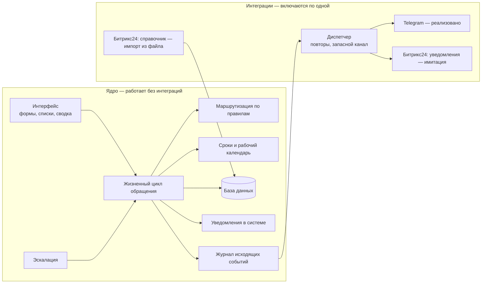
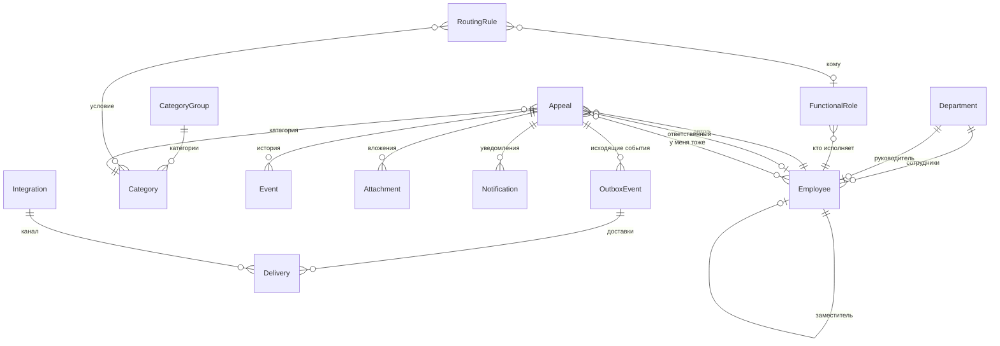
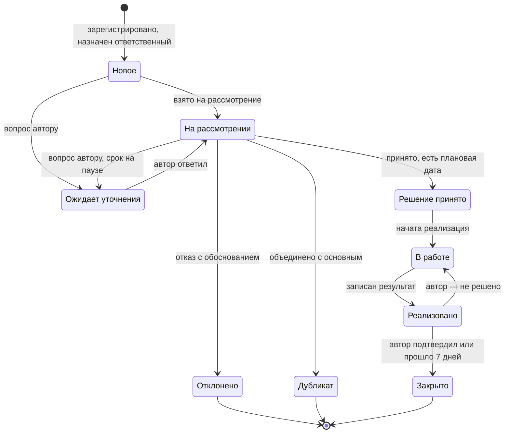
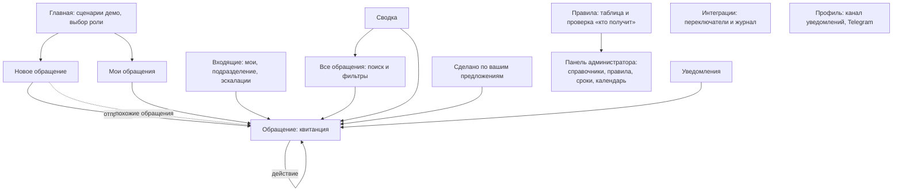

# Техническая концепция

[English version](technical-concept.en.md)

Как устроено решение: модули, данные, экраны, технологии, безопасность, ограничения MVP и путь к эксплуатации (ТЗ §3.2, §3.3, §3.5, §4.1). Процесс для каждой роли описан в [описании решения](solution-design.md); как запустить — в [README](../README.md).

## 1. Главная идея архитектуры

Собственник просил предложить, «какие модули и как это можно реализовать». Ответ — **ядро и подключаемые интеграции**.

- **Ядро** делает всё, что нужно для гарантированного ответа: обращения, правила маршрутизации, сроки, эскалацию, сводку, уведомления в системе. Оно работает без единой внешней системы.
- **Интеграции** подключаются по одной. Ядро о них не знает: оно записывает события в журнал исходящих событий, а включённые интеграции забирают их оттуда.

Поэтому действие пользователя никогда не ждёт внешнюю систему. Если Telegram или Битрикс24 недоступны, обращение всё равно регистрируется, а уведомление остаётся в системе.

## 2. Модули

| Модуль | Что делает | Где в коде |
|---|---|---|
| Справочник | подразделения, сотрудники, руководители, заместители, отметка об отсутствии, роли ответственных | `feedback/models.py`, панель администратора |
| Категории и сроки | направления и категории обращений, для каждой — срок первого ответа и сроки решения | `feedback/models.py` |
| Маршрутизация | проверяет правила по порядку, находит человека по роли, применяет цепочку замещения | `feedback/services/routing.py` |
| Жизненный цикл | регистрация, статусы, вопрос автору, решение, реализация, подтверждение; каждое действие — одна функция с проверкой прав | `feedback/services/workflow.py` |
| Рабочий календарь | считает сроки в рабочих днях; выходные, часы работы и праздники — данные, а не код | `feedback/services/workcal.py` |
| Эскалация | напоминание в последний день, затем руководитель, затем руководство; закрывает неподтверждённые результаты | `feedback/services/escalation.py` |
| Права и видимость | кто что видит и кто что может сделать | `feedback/services/permissions.py` |
| Похожие обращения | подсказка категории и поиск похожих по совпадению слов | `feedback/services/similar.py` |
| Аналитика | показатели сводки, «кто что держит», повторяющиеся темы | `feedback/services/metrics.py` |
| Уведомления | уведомления в системе и запись в журнал исходящих событий | `workflow.notify`, модели `Notification`, `OutboxEvent` |
| Интеграции | диспетчер, канал Telegram, имитация Битрикс24, импорт справочника | `feedback/integrations/` |
| Фоновая обработка | раз в несколько секунд запускает эскалацию и диспетчер | `feedback/services/worker.py` |
| Демо | часы, которые можно перемотать; загрузка демо-данных | `feedback/services/clock.py`, `seed.py` |
| Интерфейс | страницы и формы | `feedback/views.py`, `feedback/templates/` |

Логика лежит в `services/`, а не в страницах: страницы только читают ввод и показывают результат. Поэтому тесты проверяют правила процесса напрямую, а интерфейс можно заменить (например, на приложение внутри Битрикс24), не трогая ядро.

## 3. Данные

| Таблица | Что хранит |
|---|---|
| `Department`, `Employee` | оргструктура; у сотрудника — уровень доступа, заместитель, отметка об отсутствии, канал уведомлений |
| `FunctionalRole` | роль, на которую ссылается правило («IT-специалист», «Ответственный за договоры»), и кто её исполняет |
| `CategoryGroup`, `Category` | направления и категории, сроки, ключевые слова для подсказки |
| `RoutingRule` | порядок проверки, условия (тип, категории, подразделение автора, приоритет, «о действиях человека») и адресат |
| `Appeal` | обращение: тип, текст, автор, ответственный, сработавшее правило, статус, сроки, решение, результат, уровень эскалации |
| `Event` | история обращения: кто, когда, что сделал; видимость «автору» или «только участникам». Это и лента событий, и переписка, и журнал действий |
| `Attachment` | вложения |
| `Notification` | уведомления в системе |
| `OutboxEvent`, `Delivery` | журнал исходящих событий и попытки доставки с точным запросом во внешнюю систему |
| `Integration` | переключатель, режим (реализовано, имитация, в планах) и состояние каждой интеграции |
| `Holiday`, `SystemSettings` | календарь, пороги эскалации, множитель срочности |

Обращения не удаляются. Текст обращения после подачи не меняется: автор может только добавить сообщение.

### Жизненный цикл обращения

Автор видит три этапа, о которых говорил собственник: рассмотрение, решение, реализация.

## 4. Экраны и переходы

Прототип интерфейса — само работающее приложение. Снимки экранов лежат в [screenshots/](screenshots/).

| Экран | Кому | Что на нём |
|---|---|---|
| Новое обращение | всем | три обязательных поля; подсказка категории и похожие обращения; конфиденциальность; для руководителя — регистрация со слов сотрудника |
| Обращение | участникам; коллегам — если автор разрешил | этап, срок, текст, решение, история, действия по роли |
| Мои обращения | автору | статус простыми словами; блок «Нужно ваше действие» |
| Входящие | ответственным и руководителям | очередь по срокам: сначала просроченные |
| Все обращения | руководителям, координатору, руководству | поиск и фильтры по подразделению, категории, статусу, типу, сроку |
| Сводка | руководителям, координатору, руководству | показатели ТЗ, просрочка, «кто что держит», повторы, темы |
| Сделано | всем | реализованные предложения и открытые обращения коллег с кнопкой «У меня тоже» |
| Правила | всем на чтение | 16 правил, кто сейчас исполняет роль, проверка «кто получит» |
| Интеграции | всем на чтение, переключает администратор | режим каждой интеграции и журнал запросов |
| Панель администратора | администратору | категории, сроки, правила, роли, сотрудники, календарь, пороги |

Страницы рассчитаны на телефон: одна таблица стилей без отдельной мобильной версии. Сетки сами перестраиваются в одну колонку, меню прокручивается вбок, а на экране уже 640 px таблицы становятся карточками с подписями полей. Все страницы проверены на ширине 390 px: горизонтальной прокрутки нет. Снимки — [screenshots/](screenshots/), файлы 11–13.

## 5. Технологии и почему они

| Что | Выбор | Почему |
|---|---|---|
| Язык и каркас | Python 3.12, Django 5.2 (версия с длительной поддержкой) | Панель администратора из коробки закрывает требование ТЗ «администратор управляет категориями и правилами» без отдельной разработки. ORM, миграции, сессии, загрузка файлов и русская локализация входят в поставку. Распространённый стек: его проще сопровождать |
| Интерфейс | страницы, собранные на сервере, немного JavaScript без сборки | Один проект вместо двух, запуск одной командой, работает на слабом телефоне и медленной связи |
| База данных | SQLite в демо, PostgreSQL в эксплуатации | Для демо не нужен отдельный сервер; переход — одна настройка, код не меняется |
| Фоновая работа | таблица исходящих событий и свой цикл обработки | Не нужны брокер сообщений и планировщик. Событие не теряется: оно сначала записано в базу, потом отправляется |
| Telegram | Bot API через стандартную библиотеку Python | Без лишних зависимостей; бот опрашивает обновления сам, поэтому публичный адрес для него не обязателен |
| Запуск | gunicorn и WhiteNoise, Docker-файл приложен | Один процесс, один том с данными |

Зависимостей четыре: Django, WhiteNoise, gunicorn, tzdata.

**Что мы рассматривали и почему не выбрали**

| Вариант | Почему нет |
|---|---|
| Настроить смарт-процесс в Битрикс24 | Нет доступа к порталу заказчика. Нужен тариф «Профессиональный». Эскалацию к руководству, права «автор видит только своё» и экран собственника всё равно пришлось бы собирать вручную. Подробнее — в [ценностном предложении](value-proposition.md) |
| Отдельные сервер (API) и клиент (React или Vue) | Удобнее для богатого интерфейса, но это два проекта, сборка и своя панель администратора. За срок хакатона — меньше готового результата |
| Конструкторы без кода | Маршрутизацию, рабочие дни и эскалацию всё равно пришлось бы программировать |

Ядро не привязано к Django-страницам: при необходимости к нему добавляется REST API для приложения внутри Битрикс24 или мобильного клиента.

## 6. Доступ

В MVP доступ определяют три вещи: уровень доступа сотрудника (сотрудник, координатор, руководство, администратор), место в оргструктуре (руководитель подразделения видит очередь своего подразделения) и отношение к обращению (автор, ответственный).

- Каждое действие проверяется в одном месте — `permissions.actions()`; страница показывает только разрешённые кнопки, а сервер проверяет право ещё раз.
- Конфиденциальное обращение: имя автора скрыто от ответственного и руководителя подразделения, видно координатору и руководству.
- Обращение о действиях конкретного человека не видно этому человеку ни в списках, ни по прямой ссылке; просмотры записываются в историю.
- Внутренние комментарии не показываются автору.

Полные таблицы «кто что видит» и «кто что может» — в [описании решения](solution-design.md), раздел 5.

**Вход.** В демо — переключатель ролей. Следующий этап: вход через Битрикс24 (OAuth 2.0) или собственный вход по ссылке из письма. Код получает текущего сотрудника в одном месте (`feedback/middleware.py`), поэтому способ входа меняется без переделки остального.

## 7. Защита данных

- **Хранение в Казахстане.** Система рассчитана на размещение в казахстанском облаке или на сервере компании (закон «О персональных данных и их защите», ст. 12). Юридические выводы должен проверить юрист.
- **Минимум данных.** Имя, должность, подразделение, рабочая почта. Никаких паспортных и личных сведений.
- **Наружу — только номер, статус и ссылка.** В Telegram и Битрикс24 не уходят ни текст обращения, ни имена; это проверяют автоматические тесты.
- **Секреты** (токен бота, ключ приложения) задаются переменными окружения и не хранятся ни в репозитории, ни в базе, ни в журнале интеграций.
- **Вложения** ограничены по типу и размеру и отдаются только тем, кто видит обращение.
- **Журнал действий** ведётся в истории каждого обращения; изменения справочников и правил записывает панель администратора.
- **Демо-данные синтетические** (ТЗ §3.5).

## 8. Тесты

80 автоматических тестов запускаются командой `python manage.py test`. Тесты ядра идут со всеми выключенными интеграциями — так проверяется главное обещание архитектуры.

| Что проверяется | Примеры |
|---|---|
| Маршрутизация | правила воспроизводят назначение для всех 20 обращений организаторов; замещение при отсутствии; обращение о человеке не попадает к нему; никто не рассматривает своё обращение |
| Сроки | рабочие дни, праздники, пауза и продление |
| Эскалация | 1 и 3 рабочих дня просрочки, выходные не считаются, повторный запуск ничего не дублирует |
| Процесс | решение без обоснования не принимается; подтверждение и возврат в работу |
| Видимость | конфиденциальный автор скрыт; внутренние комментарии не видны автору |
| Интеграции | ядро не обращается к сети; имитация записывает точный запрос; при сбое Telegram — повторы и запасной канал |
| Демо | шесть сценариев организаторов; перемотка времени приводит к эскалации |

## 9. Ограничения MVP и путь к эксплуатации

| Сейчас | Что нужно для эксплуатации |
|---|---|
| Переключатель ролей вместо входа | Вход через Битрикс24 или собственный; выключить демо-режим (`DEMO_MODE=0`) |
| SQLite | PostgreSQL |
| Фоновая обработка — поток в веб-процессе | Отдельный процесс `python manage.py worker` (`INLINE_WORKER=0`) |
| Битрикс24 — имитация | Вебхук или приложение на портале заказчика с правами на пользователей, подразделения и уведомления |
| Telegram проверен с настоящим ботом на локальном адресе | Публичный адрес системы, чтобы в уведомлении была кнопка «Открыть», и бот, которым владеет компания |
| Календарь — демо-данные | Сверка с производственным календарём, ежегодное обновление в настройках |
| Нет резервных копий и шифрования канала | HTTPS на стороне веб-сервера, резервное копирование базы и вложений |
| Тексты интерфейса в шаблонах | Файлы перевода, затем казахский интерфейс |

Требуют отдельной технической проработки: встраивание в Битрикс24 и синхронизация оргструктуры, интеграция с 1С, анонимный режим, ИИ-подсказки с размещением модели в Казахстане.

## 10. Как проверить полезность

Пилот на 4–6 недель в одном-двух подразделениях. Показатели уже считаются в сводке: доля ответов в срок, время до первого ответа, доля обращений, назначенных правилами без ручного шага, число реализованных улучшений. План внедрения и остальные показатели — в [описании решения](solution-design.md), раздел 9.
